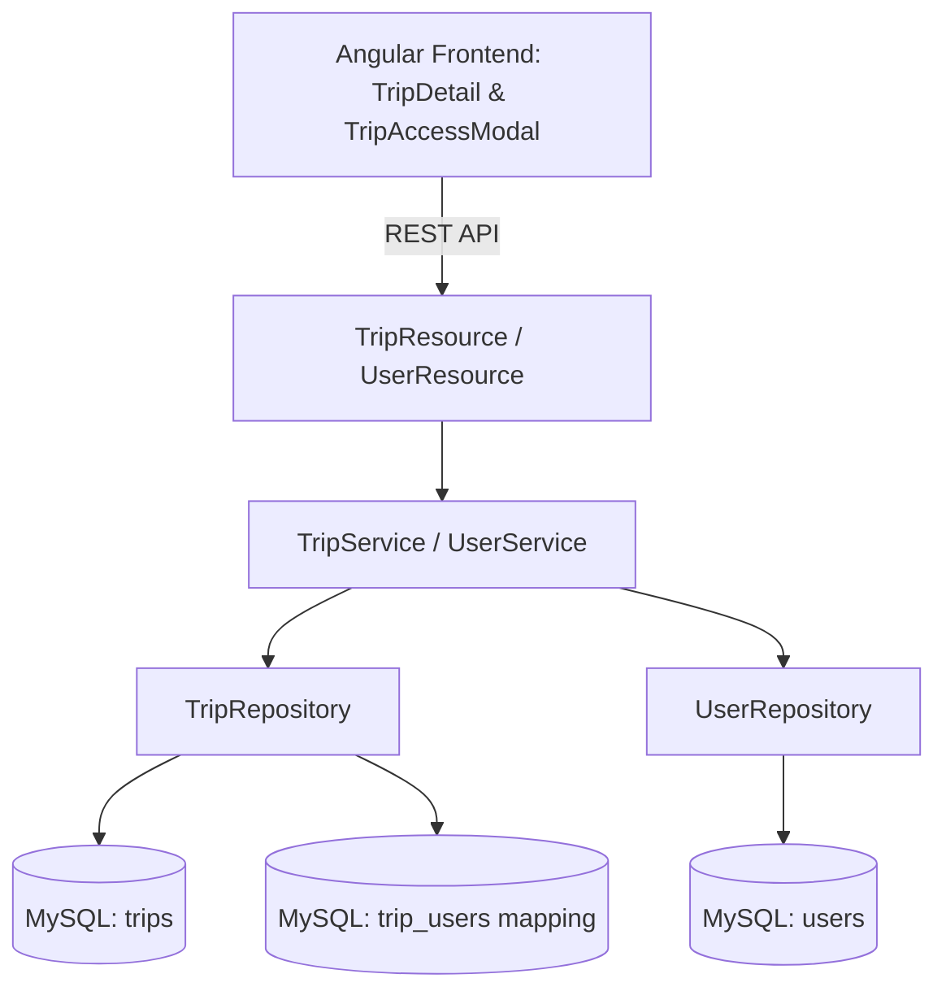

# Requirements

### Overview & Goals
Enable multi-user access to TripCheck trip records as specified in `docs/MultiUserAccess.md`. Multiple authorized users will be able to collaborate on the same trip, view its stops and checklists, and manage tasks. The system will support persistent user records, relational mapping between users and trips, API endpoints to manage trip collaborators, and an intuitive UI modal on the Trip Detail page to authorize and revoke trip access for other users.

---

### Scope
- **In Scope**:
  - Creating a persistent `User` entity and database table (`users`) to store user account information.
  - Adding a relational mapping table (`trip_users`) associating `Trip` records with multiple `User` records.
  - Removing the single-owner `user_id` column from the `trips` table.
  - Updating user registration and login workflows (`WebAuthnService` and auth controllers) to register and look up users in the database.
  - Updating `TripRepository` and `TripService` to retrieve all trips where the authenticated user is an authorized collaborator.
  - Updating `StopService` and `TaskService` security checks so any authorized trip collaborator can manage stops and tasks.
  - Creating REST endpoints for user lookup and managing trip authorizations (`GET /api/users`, `GET /api/trips/{tripId}/users`, `POST /api/trips/{tripId}/users`, `DELETE /api/trips/{tripId}/users/{username}`).
  - Building a responsive, accessible `TripAccessModalComponent` with autofocus for adding and removing authorized collaborators.
  - Integrating trip access controls into `TripDetailComponent` with real-time state updates.
  - Full automated backend and frontend test coverage.
- **Out of Scope**:
  - Complex role-based permission tiers (e.g. read-only vs admin); all authorized collaborators have full collaborative edit access to the trip.

---

### User Stories
- **US-1**: *As a trip creator*, I want my user account automatically assigned as an authorized collaborator when I create a trip so I have immediate access to it.
- **US-2**: *As a traveler*, I want to see all trips that I created or have been granted access to on my trips dashboard.
- **US-3**: *As a trip collaborator*, I want to open an access modal on the trip detail page to view all users who currently have access to the trip.
- **US-4**: *As a trip collaborator*, I want to authorize another registered user by username so we can plan and check off tasks together.
- **US-5**: *As a trip collaborator*, I want to revoke access from a user who is no longer participating in the trip, while ensuring at least one collaborator remains on the trip.

---

### Functional Requirements
- **FR-1 User Persistence & Authentication**:
  - Store registered users in the `users` table with `id`, `username` (unique, lowercase), and `display_name`.
  - During WebAuthn registration/login, ensure user records exist in the database and link authentications to the `User` entity.
- **FR-2 Multi-User Trip Association**:
  - Replace the single `user_id` column in `trips` with a `@ManyToMany` join table `trip_users` (`trip_id`, `user_id`).
  - When creating a trip, automatically associate the authenticated creator as the initial authorized user.
- **FR-3 Authorization & Access Control**:
  - A user can view, edit, delete, add stops to, and modify tasks for a trip if and only if they are associated with the trip via `trip_users`.
  - Other users receive a 404 / 403 when attempting to access or modify trips they are not authorized for.
- **FR-4 Collaborator Management Endpoints**:
  - `GET /api/users`: Retrieve registered users (for collaborator selection/autocomplete).
  - `POST /api/trips/{tripId}/users`: Add a user (by username) to the trip's authorized users.
  - `DELETE /api/trips/{tripId}/users/{username}`: Remove a user from the trip's authorized users. Prevent removing the last remaining collaborator.
  - `TripDetailResponse` includes the list of authorized users (`users: List<UserSummaryDto>`).
- **FR-5 Trip Access UI Modal**:
  - Add a "Share" / "Manage Access" button to the trip detail header.
  - Open `TripAccessModalComponent` displaying existing authorized users and an input form (with automatic autofocus) to add a user.
  - Provide remove buttons for collaborators with confirmation safeguards.

# Technical Design

### Current Implementation
- `Trip.java` has a single `@Column(name="user_id", length=100) private String userId;` column.
- `TripRepository.java` queries by `findByUserIdOrderByStartingDateAsc(String userId)`.
- `TripService.getTripEntity(id, userId)` verifies single-owner access: `trip.getUserId().equals(userId)`.
- `WebAuthnService` manages challenges and credentials in-memory without a dedicated `users` database table.
- Frontend `TripDetailComponent` allows trip editing, stop creation, and task management without collaborator management controls.

---

### Key Decisions
1. **User Entity & Persistence**:
   - *Choice*: Create a dedicated `User` JPA entity (`users` table) with `id`, `username` (unique index), and `displayName`.
   - *Rationale*: Satisfies the requirement to persist user information in MySQL, integrates with Spring Data JPA, and enables foreign key constraints on the mapping table.
2. **Relational Mapping (`trip_users`)**:
   - *Choice*: `@ManyToMany` mapping between `Trip` and `User` using join table `trip_users` with composite primary key / foreign keys (`trip_id`, `user_id`).
   - *Rationale*: Removes the single `user_id` column from `trips`, accurately models multi-user ownership, and allows clean querying and cascading.
3. **Collaborator Authorization Strategy**:
   - *Choice*: Collaborative access model where any user linked in `trip_users` can view, edit, and manage stops/tasks for the trip.
   - *Rationale*: Directly meets the multi-user trip access specification while keeping the authorization logic uniform across all stop and task operations.
4. **Access Management UI**:
   - *Choice*: Standalone Angular component `TripAccessModalComponent` adhering to the project guideline requiring `autofocus` on the primary input field.
   - *Rationale*: Consistent with existing modal patterns (`StopModalComponent`, `TaskModalComponent`, `TripEditModalComponent`).

---

### Architecture Diagram


---

### Data Models / Contracts

#### Backend Entities & DTOs
```java
// User.java
@Entity
@Table(name = "users")
@Getter
@Setter
@NoArgsConstructor
@AllArgsConstructor
@Builder
public class User {
  @Id
  @GeneratedValue(strategy = GenerationType.IDENTITY)
  private Long id;

  @NotBlank
  @Column(nullable = false, unique = true, length = 100)
  private String username;

  @Column(name = "display_name", length = 100)
  private String displayName;
}

// Trip.java updates
@ManyToMany
@JoinTable(
  name = "trip_users",
  joinColumns = @JoinColumn(name = "trip_id"),
  inverseJoinColumns = @JoinColumn(name = "user_id")
)
@Builder.Default
private Set<User> users = new HashSet<>();

// DTOs
public record UserSummaryDto(Long id, String username, String displayName) {}
public record AddTripUserRequest(@NotBlank String username) {}
```

#### API Endpoints
- `GET /api/users` -> `List<UserSummaryDto>` (list all users / search users)
- `POST /api/trips/{tripId}/users` (Body: `AddTripUserRequest`) -> `TripDetailResponse`
- `DELETE /api/trips/{tripId}/users/{username}` -> `TripDetailResponse`
- `GET /api/trips` -> `List<TripSummaryResponse>` (returns all trips where user is in `trip_users`)
- `GET /api/trips/{id}` -> `TripDetailResponse` (includes `users: List<UserSummaryDto>`)

#### Frontend Models
```typescript
// client/src/app/models/user.model.ts
export interface UserSummary {
  id: number;
  username: string;
  displayName?: string;
}

// client/src/app/models/trip.model.ts
export interface TripDetail {
  id: number;
  name: string;
  startingDate: string;
  endingDate?: string;
  users: UserSummary[];
  stops: Stop[];
  preTripTasks: Task[];
  departureDayTasks: Task[];
  returnDayTasks: Task[];
}
```

---

### File Structure
- **Backend**:
  - `server/src/main/java/com/anodyzed/tripcheck/model/User.java` (added)
  - `server/src/main/java/com/anodyzed/tripcheck/model/Trip.java` (modified: remove `userId`, add `users`)
  - `server/src/main/java/com/anodyzed/tripcheck/repository/UserRepository.java` (added)
  - `server/src/main/java/com/anodyzed/tripcheck/repository/TripRepository.java` (modified: query by user association)
  - `server/src/main/java/com/anodyzed/tripcheck/dto/UserSummaryDto.java` (added)
  - `server/src/main/java/com/anodyzed/tripcheck/dto/AddTripUserRequest.java` (added)
  - `server/src/main/java/com/anodyzed/tripcheck/dto/TripDetailResponse.java` (modified: include `users`)
  - `server/src/main/java/com/anodyzed/tripcheck/dto/TripSummaryResponse.java` (modified)
  - `server/src/main/java/com/anodyzed/tripcheck/services/UserService.java` (added)
  - `server/src/main/java/com/anodyzed/tripcheck/services/TripService.java` (modified: multi-user authorization and sharing)
  - `server/src/main/java/com/anodyzed/tripcheck/resources/UserResource.java` (added)
  - `server/src/main/java/com/anodyzed/tripcheck/resources/TripResource.java` (modified: collaborator endpoints)
  - `server/src/main/java/com/anodyzed/tripcheck/security/webauthn/WebAuthnService.java` (modified: persist/find `User`)
- **Frontend**:
  - `client/src/app/models/user.model.ts` (added)
  - `client/src/app/models/trip.model.ts` (modified: add `users` to `TripDetail`)
  - `client/src/app/services/trip.service.ts` (modified: user lookup and trip user management methods)
  - `client/src/app/features/trips/trip-access-modal/trip-access-modal.component.ts` (added)
  - `client/src/app/features/trips/trip-access-modal/trip-access-modal.component.spec.ts` (added)
  - `client/src/app/features/trips/trip-detail/trip-detail.component.ts` (modified: Share/Access button and modal integration)
  - `client/src/app/features/trips/trip-detail/trip-detail.component.spec.ts` (modified)

---

### Risks
- **Hibernate DDL Update & Schema Migration**: Removing `user_id` from `trips` and introducing `users` and `trip_users` will be automatically applied by Hibernate `ddl-auto: update`.
- **Sole Collaborator Removal**: Ensure business logic prohibits removing the last remaining collaborator from a trip to prevent orphaned trips.

# Testing

### Validation Approach
Verify all multi-user persistence, access control, REST endpoints, and UI modal flows via automated backend (`./gradlew :server:test`), frontend (`./gradlew :client:test`), and multi-module build (`./gradlew build`).

---

### Key Scenarios
1. **User Registration & Persistence**:
   - Register a new user and verify a record is inserted into `users` table.
2. **Trip Creation & Automatic Creator Association**:
   - Create a trip as user `alice` and verify `alice` is added to `trip_users`.
3. **Multi-User Collaboration**:
   - `alice` shares trip with `bob`.
   - Verify `bob` sees the trip in `getUserTrips("bob")` and can retrieve details, add stops, and update tasks.
4. **Access Control & Unauthorized Rejection**:
   - User `charlie` (not in `trip_users`) attempts to retrieve, update, or delete the trip; verify request is rejected with 404/403.
5. **Revoke Collaborator Access**:
   - Remove `bob` from the trip; verify `bob` can no longer view or modify the trip.
   - Attempt to remove `alice` when `alice` is the sole collaborator; verify operation is rejected with validation error.
6. **UI Access Modal**:
   - Open modal on Trip Detail page, verify autofocus on the username input field, add a user, and verify list updates.

---

### Test Changes
- **Backend Tests**:
  - `TripPersistenceTest.java`: Verify `User`, `Trip`, and `trip_users` table mappings and relationships.
  - `TripServiceTest.java`: Verify multi-user trip creation, authorization checks, collaborator addition/removal, and data isolation.
  - `TripResourceTest.java` & `UserResourceTest.java`: Verify REST endpoints for user listing, trip sharing, and revocation.
- **Frontend Tests**:
  - `trip.service.spec.ts`: Verify API calls for `getUsers`, `addTripUser`, and `removeTripUser`.
  - `trip-access-modal.component.spec.ts`: Test modal rendering, autofocus on input, adding a collaborator, removing a collaborator, and input validation.
  - `trip-detail.component.spec.ts`: Test opening access modal and reacting to collaborator updates.

# Delivery Steps

### ✓ Step 1: User Entity, Persistence, and WebAuthn Integration
Database schema and authentication service support persistent user accounts and user discovery.

- Create `User.java` JPA entity (`users` table) with `id`, `username`, and `displayName`.
- Create `UserRepository.java` with query methods (`findByUsernameIgnoreCase`, `findAllByOrderByUsernameAsc`).
- Update `WebAuthnService.java` to ensure a `User` entity is created or retrieved during WebAuthn registration/login.
- Create `UserService.java` and `UserResource.java` exposing `GET /api/users` for collaborator lookups.
- Add unit and persistence tests in `TripPersistenceTest.java` and `TripServiceTest.java`.

### ✓ Step 2: Trip-User Mapping and Multi-User Authorization
Trip persistence and services support multiple collaborators per trip via the `trip_users` mapping table and enforce access control.

- Update `Trip.java` to replace `userId` with `@ManyToMany` `trip_users` relationship (`Set<User> users`).
- Update `TripRepository.java` to find trips associated with a user via the mapping table (`findByUsers_UsernameIgnoreCaseOrderByStartingDateAsc`).
- Update `TripService.java` to associate creators on trip creation, validate collaborator membership in `getTripEntity`, and implement `addCollaborator` and `removeCollaborator`.
- Update `TripDetailResponse.java` and `TripSummaryResponse.java` to include authorized collaborator details (`UserSummaryDto`).
- Update `TripResource.java` with `POST /api/trips/{tripId}/users` and `DELETE /api/trips/{tripId}/users/{username}` endpoints.
- Update `StopService.java` and `TaskService.java` to ensure all operations validate multi-user authorization.
- Add backend service and REST integration tests covering multi-user collaboration and isolation.

### ✓ Step 3: Frontend User Models, Services, and Trip Access Modal
Angular client models, services, and a dedicated modal component support viewing and managing trip collaborators.

- Create `client/src/app/models/user.model.ts` and update `TripDetail` in `trip.model.ts` with `users: UserSummary[]`.
- Add `getUsers()`, `addTripUser(tripId, username)`, and `removeTripUser(tripId, username)` methods to `TripService`.
- Create `TripAccessModalComponent` with autofocus on the user input field, list of current collaborators, add user form, and remove collaborator actions.
- Add unit test suite for `TripAccessModalComponent` in `trip-access-modal.component.spec.ts`.

### ✓ Step 4: Integrate Access Modal into Trip Detail UI and E2E Verification
Trip Detail screen provides access management controls and validates end-to-end multi-user workflows.

- Add "Share" / "Access" button to `TripDetailComponent` header and bind modal open/close state.
- Wire modal events (`userAdded`, `userRemoved`) to `TripService` and update local trip state.
- Update `trip-detail.component.spec.ts` with test cases for collaborator management.
- Update documentation in `docs/ToDo.md` and `docs/MultiUserAccess.md` as needed.
- Run full automated test suites (`./gradlew :server:test`, `./gradlew :client:test`, `./gradlew build`) to verify the entire system.