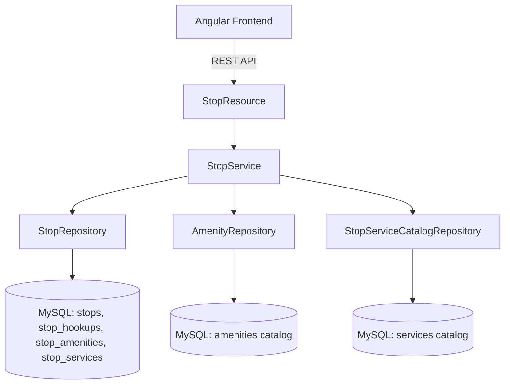

# Requirements

### Overview & Goals
Extend the itinerary `Stop` domain model, REST API, and Angular frontend to support rich campsite / lodging details:
1. **Hookups**: Multi-selection of standard utility hookups ("Electric", "Water", "Sewer").
2. **Check-in & Check-out**: Time of day values indicating arrival and departure check times.
3. **Amenities & Services**: Jira-style label management where users can tag stops with features (e.g. *Trails*, *Water Access*, *Laundry*, *Propane*), and newly typed labels automatically expand the system's suggestion pool for future stops.
4. **Codes**: Free-form text field (up to 128 characters) for gate codes, lockbox combinations, WiFi passwords, etc.

---

### Scope
- **In Scope**:
  - Updating MySQL database entities, schema mappings, DTOs, validation, and REST controllers.
  - Automatic persistence of previously unknown Amenity and Service labels into catalog tables.
  - Suggestion endpoints (`GET /api/stops/amenities`, `GET /api/stops/services`) for client autocompletion.
  - Adding form inputs for all 5 new field groups to `StopModalComponent` (Add Stop), `StopEditModalComponent` (Edit Stop), and `StopCloneModalComponent` (Clone Stop).
  - Displaying all new fields with intuitive visual indicators (badges, chips, time formatting) on `StopCardComponent`.
  - Updating Stop cloning logic to copy all new fields to duplicated stops.
  - Full automated backend and frontend test coverage.
- **Out of Scope**:
  - Standalone label management administration screen (labels are created dynamically on-the-fly like Jira labels).

---

### User Stories
- **US-1**: *As a traveler*, I want to record available hookups (Electric, Water, Sewer) for each stop so I know what utilities are available at the site.
- **US-2**: *As a traveler*, I want to record check-in and check-out times so I can coordinate arrival and departure schedules.
- **US-3**: *As a traveler*, I want to tag stops with Amenities and Services using quick label chips, and have previously entered labels suggested as I type, so that entering stop features is fast and consistent.
- **US-4**: *As a traveler*, I want to store access codes (gate codes, WiFi passwords, keybox pins) up to 128 characters so I have them readily accessible on the stop card.
- **US-5**: *As a traveler*, I want all these fields preserved when cloning a stop so I can easily duplicate recurring site setups.

---

### Functional Requirements
- **FR-1 Hookups**:
  - Accepts any combination of `"Electric"`, `"Water"`, `"Sewer"`.
  - Displayed as toggleable checkboxes/chips in modals and badges on the stop card.
- **FR-2 Check-in & Check-out**:
  - Stores time of day in `HH:mm` format (e.g., `15:00`, `11:00`).
  - Rendered via `<input type="time">` in modals and formatted in 12-hour/24-hour readable format on the stop card.
- **FR-3 Amenities & Services (Jira-style Labels)**:
  - Users can select existing labels or type custom labels.
  - Hitting Enter or comma creates a new label chip.
  - When saving a stop, any new label not previously in the catalog is stored in the database catalog.
  - The UI suggests existing labels using an autocomplete datalist or dropdown.
- **FR-4 Codes**:
  - Text field with max length of 128 characters.
  - Displayed in stop details grid with easy readability.
- **FR-5 Cloning**:
  - Cloning a stop pre-populates all 5 new field groups in the clone dialog and clones them when confirmed.

# Technical Design

### Current Implementation
- `Stop.java` currently contains: `name`, `stopDate`, `location`, `numberOfNights`, `webAddress`, `telephoneNumber`, `confirmationCode`, `siteNumber`, `notes`, `orderIndex`, `trip`, and `tasks`.
- DTOs (`CreateStopRequest`, `UpdateStopRequest`, `CloneStopRequest`, `StopResponse`) and TypeScript interfaces (`Stop`, `CreateStopDto`, `UpdateStopDto`, `CloneStopDto`) mirror these fields.
- `StopModalComponent`, `StopEditModalComponent`, and `StopCloneModalComponent` capture these standard fields.
- `StopCardComponent` renders details in `.stop-details-grid`.

---

### Key Decisions
1. **Hookups Storage**:
   - *Choice*: JPA `@ElementCollection` table `stop_hookups` with enum/string values `"Electric"`, `"Water"`, `"Sewer"`.
   - *Rationale*: Clean relational mapping, naturally handles multi-selection, and aligns with JPA best practices without messy comma-delimited string parsing.
2. **Time Storage**:
   - *Choice*: `java.time.LocalTime` for `checkinTime` and `checkoutTime`, mapped to `TIME` column in MySQL and formatted as `"HH:mm"` ISO strings in JSON.
   - *Rationale*: Standard Java time type for time-of-day without date context, with direct `<input type="time">` compatibility in HTML5.
3. **Jira-style Label Management for Amenities & Services**:
   - *Choice*: Separate `@ElementCollection` tables for stop associations (`stop_amenities`, `stop_services`) plus master catalog entities `Amenity` and `StopServiceCatalog` (`amenities` and `services` tables).
   - *Rationale*: Provides fast per-stop associations while maintaining a persistent global pool of labels that grows automatically whenever an unseen label is entered.
4. **Codes Field**:
   - *Choice*: `@Column(name="codes", length=128)` string field with `@Size(max=128)`.
   - *Rationale*: Direct mapping matching the required character length.

---

### Architecture Diagram


---

### Data Models / Contracts

#### Backend Entities & DTOs
```java
// Model additions in Stop.java
@ElementCollection
@CollectionTable(name = "stop_hookups", joinColumns = @JoinColumn(name = "stop_id"))
@Column(name = "hookup")
@Builder.Default
private Set<String> hookups = new HashSet<>();

@Column(name = "checkin_time")
private LocalTime checkinTime;

@Column(name = "checkout_time")
private LocalTime checkoutTime;

@ElementCollection
@CollectionTable(name = "stop_amenities", joinColumns = @JoinColumn(name = "stop_id"))
@Column(name = "amenity")
@Builder.Default
private Set<String> amenities = new HashSet<>();

@ElementCollection
@CollectionTable(name = "stop_services", joinColumns = @JoinColumn(name = "stop_id"))
@Column(name = "service")
@Builder.Default
private Set<String> services = new HashSet<>();

@Column(name = "codes", length = 128)
@Size(max = 128)
private String codes;
```

#### DTO Updates (`CreateStopRequest`, `UpdateStopRequest`, `CloneStopRequest`, `StopResponse`)
```java
private Set<String> hookups;
@JsonFormat(pattern = "HH:mm")
private LocalTime checkinTime;
@JsonFormat(pattern = "HH:mm")
private LocalTime checkoutTime;
private Set<String> amenities;
private Set<String> services;
@Size(max = 128)
private String codes;
```

#### API Endpoints
- `GET /api/stops/amenities` -> `List<String>` (distinct known amenity labels)
- `GET /api/stops/services` -> `List<String>` (distinct known service labels)

#### Frontend Models (`stop.model.ts`)
```typescript
export interface Stop {
  // ... existing fields ...
  hookups?: string[];
  checkinTime?: string;
  checkoutTime?: string;
  amenities?: string[];
  services?: string[];
  codes?: string[];
}
```

---

### File Structure
- **Backend**:
  - `server/src/main/java/com/anodyzed/tripcheck/model/Stop.java` (modified)
  - `server/src/main/java/com/anodyzed/tripcheck/model/Amenity.java` (added)
  - `server/src/main/java/com/anodyzed/tripcheck/model/StopServiceCatalog.java` (added)
  - `server/src/main/java/com/anodyzed/tripcheck/repository/AmenityRepository.java` (added)
  - `server/src/main/java/com/anodyzed/tripcheck/repository/StopServiceCatalogRepository.java` (added)
  - `server/src/main/java/com/anodyzed/tripcheck/dto/CreateStopRequest.java` (modified)
  - `server/src/main/java/com/anodyzed/tripcheck/dto/UpdateStopRequest.java` (modified)
  - `server/src/main/java/com/anodyzed/tripcheck/dto/CloneStopRequest.java` (modified)
  - `server/src/main/java/com/anodyzed/tripcheck/dto/StopResponse.java` (modified)
  - `server/src/main/java/com/anodyzed/tripcheck/services/StopService.java` (modified)
  - `server/src/main/java/com/anodyzed/tripcheck/resources/StopResource.java` (modified)
- **Frontend**:
  - `client/src/app/models/stop.model.ts` (modified)
  - `client/src/app/services/trip.service.ts` (modified)
  - `client/src/app/features/stops/stop-card/stop-card.component.ts` (modified)
  - `client/src/app/features/stops/stop-modal/stop-modal.component.ts` (modified)
  - `client/src/app/features/stops/stop-edit-modal/stop-edit-modal.component.ts` (modified)
  - `client/src/app/features/stops/stop-clone-modal/stop-clone-modal.component.ts` (modified)

---

### Risks
- **Hibernate DDL Schema Updates**: Collection tables (`stop_hookups`, `stop_amenities`, `stop_services`) and master catalog tables (`amenities`, `services`) will be automatically created by Hibernate `ddl-auto: update`.
- **Case-Insensitive Label Deduplication**: When adding new labels to the catalog, trim and perform case-insensitive checks to avoid duplicate labels like "Trails" and "trails".

# Testing

### Validation Approach
Automated verification across unit, persistence, API integration, and frontend component tests using `./gradlew build`, `./gradlew :server:test`, and `./gradlew :client:test`.

---

### Key Scenarios
1. **Hookups Selection & Persistence**:
   - Select multiple hookup options (e.g. Electric + Water).
   - Verify persistence in `stop_hookups` and rendering on Stop Card with appropriate badges.
2. **Check-in / Check-out Times**:
   - Set check-in to `15:00` and check-out to `11:00`.
   - Verify proper time format round-trip over REST and display on the stop card.
3. **Jira-Style Amenities & Services Labels**:
   - Add new labels (e.g. "Trails", "Scenic View") to a stop.
   - Verify stop association is saved and master catalog records are created.
   - Query `GET /api/stops/amenities` and ensure "Trails" and "Scenic View" appear in subsequent autocomplete suggestions.
4. **Codes Field (Max 128 chars)**:
   - Enter gate/door codes up to 128 characters.
   - Verify validation fails if string exceeds 128 characters.
5. **Stop Cloning**:
   - Clone a stop with hookups, checkin/checkout times, amenities, services, and codes.
   - Verify the cloned stop preserves all new fields.

---

### Test Changes
- **Backend Tests**:
  - `TripPersistenceTest.java`: Verify persistence of hookups, times, codes, and label collections on `Stop`.
  - `TripServiceTest.java`: Verify stop creation, update, cloning, and catalog suggestion additions.
  - `TripResourceTest.java`: Verify REST endpoints for CRUD and label suggestions.
- **Frontend Tests**:
  - `trip.service.spec.ts`: Verify `getAmenities()` and `getServices()` HTTP requests.
  - `stop-modal.component.spec.ts`: Test adding new stop with all 5 new field types.
  - `stop-edit-modal.component.spec.ts`: Test editing existing stop with pre-populated values.
  - `stop-clone-modal.component.spec.ts`: Test cloning stop with all fields pre-populated.
  - `stop-card.component.spec.ts`: Test rendering of hookup badges, times, amenity/service chips, and codes.

# Delivery Steps

### ✓ Step 1: Backend Data Models, Persistence, and Label Catalogs
The backend entities (`Stop`, `Amenity`, `StopServiceCatalog`), repositories, and database schema mappings support Hookups, Checkin/Checkout times, Amenities, Services, and Codes.

- Add `@ElementCollection` mappings for `hookups`, `amenities`, and `services` in `Stop.java` with corresponding collection tables (`stop_hookups`, `stop_amenities`, `stop_services`).
- Add `checkinTime` (`LocalTime`), `checkoutTime` (`LocalTime`), and `codes` (`varchar(128)`) columns to `Stop.java`.
- Create `Amenity.java` and `StopServiceCatalog.java` JPA entities to persist master lists of previously entered labels.
- Create `AmenityRepository.java` and `StopServiceCatalogRepository.java` for querying and saving label suggestions.
- Update `Trip.addClonedStop` and stop helper methods to clone all new fields and collections to cloned stops.
- Add backend persistence unit tests in `TripPersistenceTest.java` verifying column mapping and cascading.

### ✓ Step 2: Backend Service Logic, DTOs, and REST Endpoints
REST endpoints and DTOs handle CRUD and suggestion retrieval for the new Stop fields and Jira-like label catalogs.

- Update `CreateStopRequest.java`, `UpdateStopRequest.java`, `CloneStopRequest.java`, and `StopResponse.java` with `hookups`, `checkinTime`, `checkoutTime`, `amenities`, `services`, and `codes`.
- Update `StopService.java` to map new fields on stop creation, update, and cloning, automatically inserting any previously unseen amenity or service labels into the master catalog.
- Add catalog lookup endpoints `GET /api/stops/amenities` and `GET /api/stops/services` in `StopResource.java`.
- Add backend unit and integration tests in `TripServiceTest.java` and `TripResourceTest.java` covering validation, persistence, cloning, and catalog growth.

### ✓ Step 3: Frontend Models, Services, and Tag Input Components
Angular models, services, and reusable chip/tag input controls support Hookup selection, Checkin/Checkout time inputs, Codes, and Jira-like Amenities/Services label management.

- Update TypeScript interfaces (`Stop`, `CreateStopDto`, `UpdateStopDto`, `CloneStopDto`) in `client/src/app/models/stop.model.ts`.
- Add catalog fetching methods `getAmenities()` and `getServices()` to `TripService` in Angular.
- Create/integrate a tag-input component or chip editor for Amenities and Services supporting typing, Enter to add, backspace to remove, and datalist / autocomplete suggestions.
- Add unit tests for Angular models and service methods in `trip.service.spec.ts`.

### ✓ Step 4: Integrate New Fields into Stop Modals and Stop Card UI
Users can view, create, edit, and clone stops with all new fields across Stop Modals and Stop Cards.

- Update `StopModalComponent` (`Add Stop`) with Hookup checkboxes, time inputs for Checkin/Checkout, Amenities/Services tag inputs, and Codes input.
- Update `StopEditModalComponent` (`Edit Stop`) to pre-populate and edit all new fields.
- Update `StopCloneModalComponent` (`Clone Stop`) to pre-populate and edit all new fields during stop duplication.
- Update `StopCardComponent` template and styles to render Hookup badges, Checkin/Checkout times, Amenity/Service chips, and Codes.
- Update frontend component unit test suites in `stop-modal.component.spec.ts`, `stop-edit-modal.component.spec.ts`, `stop-clone-modal.component.spec.ts`, and `stop-card.component.spec.ts`.